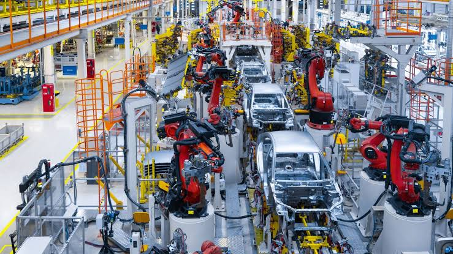

# Equipment Health and Failure-Risk Analytics for Industrial Operations

**An educational research project connecting Mechanical Engineering and Data Analytics.**

## Overview

I developed this project to explore how engineering knowledge and data analytics can work together to investigate equipment health and failure patterns.

Drawing on my Mechanical Engineering background and studies in Data Analytics, I examined operating measurements such as temperature, rotational speed, torque and tool wear. The project follows an analytical workflow from data understanding and quality checks to SQL analysis, machine-learning classification and dashboard development.

My objective was to investigate the evidence rather than confirm a predetermined conclusion. I wanted to understand which initial expectations the data supported, where the evidence was incomplete and what unexpected findings could teach me.

## Research Objective

**Which recorded operating conditions are associated with equipment failure, and how effectively can classification models distinguish failure observations from non-failure observations?**

The investigation focuses on:

- Understanding the dataset and the engineering meaning of its variables.
- Identifying data-quality issues and documenting how they are handled.
- Exploring relationships between operating conditions and failure outcomes.
- Comparing machine-learning models through their predictions and errors.
- Communicating findings clearly while distinguishing evidence from assumptions.

## Initial Expectations

The analysis was guided by the following expectations:

- **Tool wear:** Greater accumulated tool-use time would be associated with failure.
- **Torque and speed:** Examining torque and rotational speed together would reveal operating patterns associated with failure.
- **Temperature conditions:** A smaller process-to-air temperature difference, particularly at lower speed, would be associated with failure.
- **Product type:** Failure rates would differ across product categories.
- **Machine learning:** Operating measurements would help trained classifiers detect failures missed by an always-no-failure baseline.

These were starting points for investigation, not assumed conclusions. I examined them through descriptive analysis and model evaluation rather than formal statistical hypothesis tests.

The [findings report](reports/findings.md) compares these expectations with the actual evidence, including relationships that were only partly supported or require further analysis.

## Analytical Approach

I began by inspecting the dataset and checking missing values, identifiers, categories, measurement ranges and consistency between failure labels. Where conflicting information could not be resolved, I retained the original values and documented the uncertainty.

Exploratory analysis compared operating conditions across failure and non-failure observations. SQL queries provided another way to investigate the data and cross-check selected summaries. Tableau brought the descriptive findings together in a dashboard.

For machine learning, I compared an always-no-failure baseline, logistic regression and random forest using the same stratified training and test split. Evaluation considered detected failures, missed failures and false alarms—not accuracy alone.

## Tools and Methods

| Area | Tools and application |
|---|---|
| Data understanding and quality | Python and pandas for inspecting data types, missing values, identifiers, categories and label consistency |
| Exploratory analysis | pandas and Matplotlib for grouped summaries, distributions and operating-condition comparisons |
| SQL analysis | MySQL queries using aggregation, grouping, ordering and conditional filtering |
| Machine learning | Scikit-learn: always-no-failure baseline, logistic regression and random forest |
| Model preparation | Stratified train/test splitting, preprocessing pipelines, categorical encoding, numeric scaling for logistic regression and balanced class weights |
| Model evaluation | Accuracy, precision, recall, F1 scores and confusion matrices |
| Dashboard development | Tableau calculated measures, KPI summaries and analytical charts |
| Version control | Git branches, incremental commits and GitHub pull requests |

## Tableau Dashboard

The dashboard presents recorded failure outcomes alongside product categories and operating measurements. It includes overall summaries, failure rates by product type, torque and speed comparisons, median tool wear and failure-mode counts.

The dashboard describes the observed dataset. It does not display model predictions or forecast future failures.

[Read the detailed dashboard interpretation](reports/tableau-results.md) · [View the workbook documentation](dashboard/README.md)

## Results and Documentation

Detailed results are maintained separately from this overview:

- **[Findings and conclusions](reports/findings.md):** hypotheses, observed evidence, model comparisons, interpretation and limitations.
- **[Tableau results](reports/tableau-results.md):** explanations of the dashboard charts and their analytical meaning.
- **[Python analysis and modeling](notebooks/):** scripts covering data understanding, quality checks, exploration and classification.
- **[SQL analysis](sql/README.md):** analytical questions, query methods and links to the SQL code.
- **[Dataset documentation](data/README.md):** source attribution and local data setup.
- **[Data dictionary](data/data-dictionary.md):** column definitions and intended roles.

## Research Context and Limitations

This is an **educational research and portfolio project**, not a deployed industrial maintenance system.

The study uses the **AI4I 2020 Predictive Maintenance Dataset**, a **synthetic dataset** distributed through the UCI Machine Learning Repository. Its observations were generated to represent industrial operating conditions; they were not collected from a real factory for this project.

The analysis investigates associations and evaluates failure classification. It does not establish causal relationships, a defined warning period before breakdown or measurable maintenance savings.

Model evaluation used one train/test split, and exploratory analysis of the full dataset preceded modeling. The results have not been externally validated. Applying this approach in industry would require real equipment histories, measurements available before failure, further evaluation and assessment by maintenance engineers.

Raw data, generated outputs and private learning notes are maintained locally and excluded from GitHub.

## Dataset Attribution

AI4I 2020 Predictive Maintenance Dataset (2020), UCI Machine Learning Repository.

[Dataset DOI](https://doi.org/10.24432/C5HS5C) · Dataset license: CC BY 4.0

## Author

**Sai Bhaskar Chundru**  
Mechanical Engineering background | Data Analytics  
[GitHub Profile](https://github.com/SaiBhaskar72)